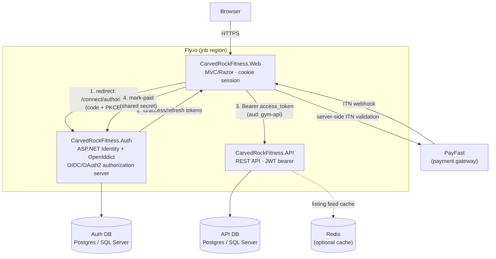

# CarvedRock Fitness / Sport & Health Meetups SA

[](https://dotnet.microsoft.com)
[](.github/workflows/ci.yml)
[](LICENSE)

A community sport & health listings platform for South Africa, with a youth-academy transport
and registration module ("YVEDA Academy"), PayFast-based paid listings, and a lightweight OIDC
identity provider. Built as three cooperating ASP.NET Core 9 applications and deployed to
Fly.io (Johannesburg region).

> This README describes the system as it is actually implemented. For a point-in-time security
> and architecture review, see `repo_analysis_output/` in a scanning workspace, or request a fresh
> `cab-scan`.

## Applications

| App | Project | Responsibility |
|---|---|---|
| **Web** | `CarvedRockFitness.Web` | MVC/Razor front end. Cookie session + OpenID Connect login, PayFast checkout, suggestion/listing creation, Academy registration forms, admin dashboard. |
| **API** | `CarvedRockFitness.API` | REST API and the primary database. Suggestions/listings, Academy registrations, drivers & driver applications, ratings/reviews, ad banners, admin settings. JWT-bearer protected. |
| **Auth** | `CarvedRockFitness.Auth` | Identity provider: ASP.NET Core Identity + OpenIddict. Issues OIDC/OAuth2 tokens (authorization code + PKCE, refresh tokens) consumed by Web and API. |

Two test projects: `CarvedRockFitness.API.Tests` (unit) and `CarvedRockFitness.API.IntegrationTests`
(integration, via `WebApplicationFactory` + EF Core InMemory). See [TESTING.md](TESTING.md).

## Architecture



- **Login**: Web redirects to Auth's `/connect/authorize` (authorization code + PKCE). Auth
  authenticates against ASP.NET Identity and issues an OIDC id/access/refresh token set via
  OpenIddict. Web stores tokens in the encrypted auth cookie and silently refreshes them before
  expiry.
- **API access**: Web attaches the user's access token (JWT, `aud: gym-api`) as a Bearer token
  when calling the API. The API validates the token against Auth's JWKS and enforces
  `[Authorize]`/role policies per endpoint.
- **Payments**: PayFast handles card/EFT payment collection for the Premium listing plan and the
  Academy transport fee. The Web app verifies PayFast's ITN webhook (local signature check +
  PayFast's own server-side validation + amount check) before marking a user as paid via an
  internal, shared-secret-protected endpoint on Auth.
- **Caching**: the API uses Redis in production (`Cache:Redis` config) or an in-memory cache in
  development, mainly to cache paginated listing feeds.

## Tech stack

- **.NET 9**, ASP.NET Core (MVC + Web API)
- **EF Core 9** — SQL Server/LocalDB for local development; Npgsql/PostgreSQL in Fly.io
  deployments (driven by `DATABASE_URL`/`DATABASE_URL_AUTH` env vars)
- **ASP.NET Core Identity** + **OpenIddict 5** (OIDC/OAuth2 authorization server)
- **Serilog** for structured logging
- **Swashbuckle/Swagger** (API docs, Development-only by default)
- **xUnit, Moq, FluentAssertions, EF Core InMemory** for tests
- **PayFast** for payments (South African payment gateway)
- Bootstrap, Leaflet/OpenStreetMap, jQuery (CDN-hosted) for the UI

## Getting started (local development)

### Prerequisites
- .NET 9 SDK
- SQL Server LocalDB (Windows) or a reachable SQL Server/PostgreSQL instance
- (Optional) `dotnet-ef` global tool for migrations: `dotnet tool install --global dotnet-ef`

### Run the three apps

Each app has its own `appsettings.Development.json` you may want to create for local secrets
(it's gitignored). At minimum set connection strings/PayFast keys/signing cert password as
needed — see `appsettings.json` in each project for the configuration keys used.

```powershell
# Terminal 1 — Auth (OIDC provider)
dotnet run --project CarvedRockFitness.Auth

# Terminal 2 — API
dotnet run --project CarvedRockFitness.API

# Terminal 3 — Web
dotnet run --project CarvedRockFitness.Web
```

On first run in `Development`, the Auth app seeds the `FreeUser`/`PaidUser`/`Admin` roles and a
set of local-only test accounts with randomly generated passwords (logged to the console on
first boot) — these are never created outside `Development`. The API seeds academy/driver/rating
demo data the same way (gated behind `IsDevelopment()`), via raw SQL for Postgres or
`dotnet ef database update` migrations for SQL Server.

### Database migrations (SQL Server/local dev)

```powershell
dotnet tool install --global dotnet-ef
dotnet ef database update --project CarvedRockFitness.API
dotnet ef database update --project CarvedRockFitness.Auth
```

In Fly.io/Postgres deployments, the API applies/validates its operational tables via idempotent
`CREATE TABLE IF NOT EXISTS` statements at startup (see `CarvedRockFitness.API/Program.cs`); the
tracked EF migrations in `Migrations/` describe the same schema for SQL Server and for reference.

### Tests

```powershell
dotnet test
```

See [TESTING.md](TESTING.md) for test organization and how integration tests fake authentication.

## Key features

- **Community listings** ("suggestions"): create, browse, pin/boost (admin), moderate, with
  optional image upload, map location and contact details.
- **YVEDA Academy**: player registration (with POPIA consent capture), driver roster and
  applications, ratings/reviews with moderation, transport route assignment.
- **Admin dashboard**: user management (ban/unban, role changes), content moderation, ad banner
  management, toggling visibility of demo data (persisted across restarts).
- **Payments**: PayFast checkout for Premium listings and Academy transport fees, with
  signature + server-side ITN validation before granting paid status.
- **Rate limiting** per endpoint class (reads, admin, and anonymous write endpoints), keyed on
  the real client IP (`Fly-Client-IP`, forwarded from Web to API) rather than the originating
  proxy's address.
- **Health checks**: `/healthz/live` (process up), `/healthz/ready` (DB reachable), `/healthz`
  (combined) on the API; `/healthz` on Auth.

## Security

See [SECURITY.md](SECURITY.md) for how to report vulnerabilities. Notable controls in place:
account lockout on repeated failed logins, CSRF protection (anti-forgery tokens) on all MVC
POST actions, image upload validated by extension + magic bytes + size limit, role-based API
authorization, and security headers (CSP, HSTS, X-Frame-Options, etc.) on both MVC apps.

## Deployment

Each app has its own `Dockerfile` and `fly.toml` and is deployed independently:

```powershell
fly deploy --config CarvedRockFitness.Auth/fly.toml
fly deploy --config CarvedRockFitness.API/fly.toml
fly deploy --config CarvedRockFitness.Web/fly.toml
```

Required secrets (set via `fly secrets set` per app, never committed):

| App | Secrets |
|---|---|
| Auth | `DATABASE_URL_AUTH`, `SIGNING_CERT_PASSWORD`, `ServiceAuth__PaymentsWebhookSecret` |
| API | `DATABASE_URL`, (optional) `Cache__Redis` |
| Web | `PayFast__MerchantId`, `PayFast__MerchantKey`, `PayFast__PassPhrase`, `ServiceAuth__PaymentsWebhookSecret` |

`ServiceAuth__PaymentsWebhookSecret` must be the same value in both Web and Auth — it
authenticates the Web→Auth "mark user as paid" call after a PayFast payment is verified.

## CI/CD

GitHub Actions (`.github/workflows/ci.yml`) builds the solution and runs both test projects on
every push/PR. Dependabot (`.github/dependabot.yml`) keeps NuGet packages and Actions up to date.
CodeQL (`.github/workflows/codeql.yml`) scans for common C# vulnerability patterns.

## Roadmap / known limitations

- **.NET 9 goes out of support 10 Nov 2026** — plan an upgrade to .NET 10 LTS (and OpenIddict 7)
  before then.
- The API and Auth databases model two separate "user" concepts (a legacy trainer/trainee
  `User` entity in the API, and the real `ApplicationUser` identity in Auth) — a future cleanup
  could unify or clearly separate these.
- Demo/seed data and the schema-maintenance raw SQL in `CarvedRockFitness.API/Program.cs` is a
  pragmatic fit for a small single-maintainer deployment; a larger team would want this fully
  migration-driven with a release pipeline step instead.

## Contributing

Open an issue or PR. Run `dotnet test` before submitting, and see [TESTING.md](TESTING.md) for
how the test suites are structured.

## License

All rights reserved — see [LICENSE](LICENSE). This code is public for viewing only; no usage,
copying, modification, or redistribution is permitted without the copyright holder's written
permission. Contact [@GawdSizwe](https://github.com/GawdSizwe) for licensing inquiries.
