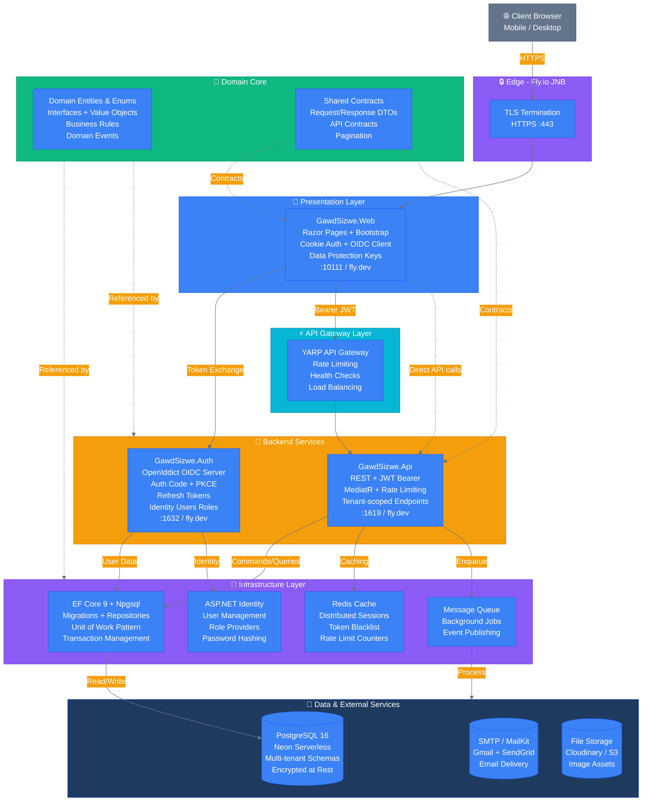
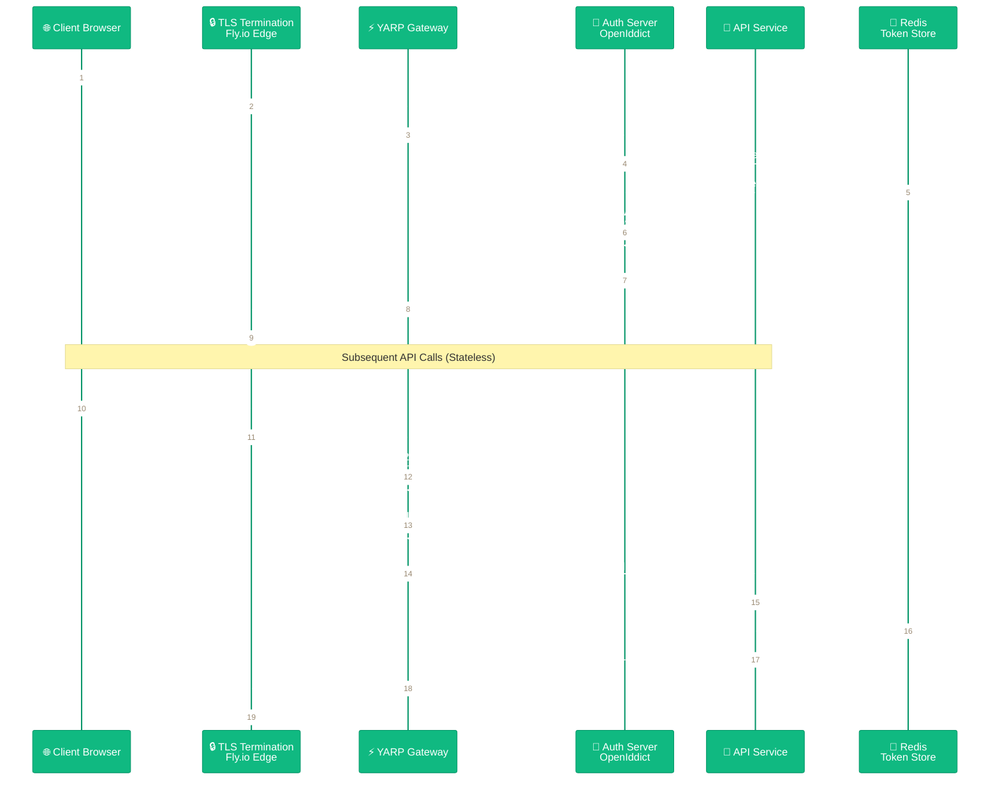
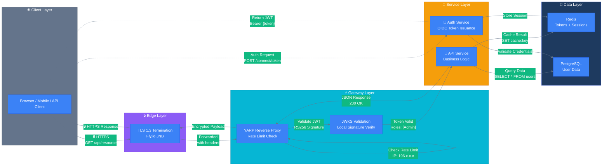
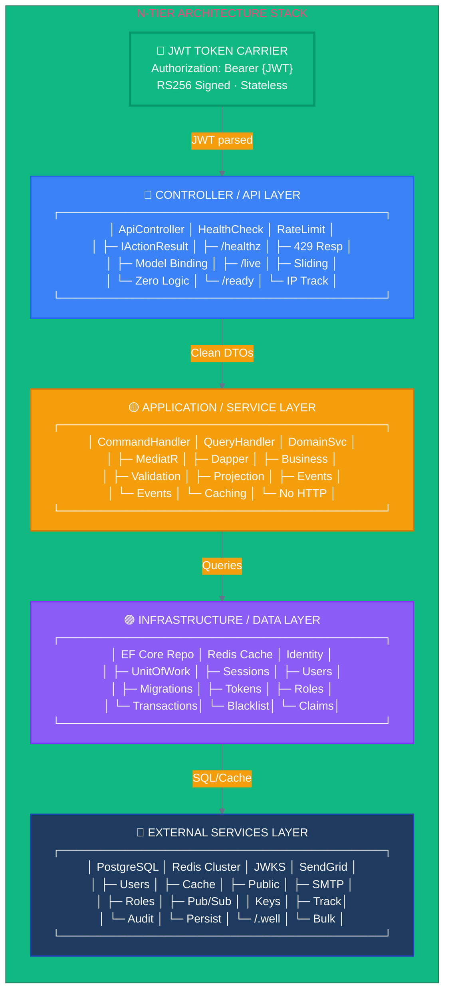

<div align="center">

# GawdSSO

### Production-Grade · Self-Hosted · OIDC Compliant · Edge-Deployed

[](https://dotnet.microsoft.com)
[](https://redis.io)
[](https://github.com/microsoft/reverse-proxy)
[](https://fly.io)
[](LICENSE)

---

**API Gateway (YARP) · RS256 Token Authority · Live Admin Dashboard · Background Key Rotation · Mobile-Ready**

---

A stateless identity platform that issues RS256-signed JWTs via OIDC/JWKS, enforces rate-limited token issuance through YARP, and manages sessions in Redis. Deployed to Fly.io's Johannesburg edge with zero vendor lock-in.

---

[Live Demo](#live-demo) | [Architecture](#architecture) | [Security](#security-architecture) | [Tech Stack](#technical-stack) | [Quick Start](#quick-start) | [Features](#features) | [Observability](#observability) | [Deployment](#deployment) | [Laws](#the-laws-behind-it)

---

### Built By

**Sizwe Mazibuko** -- Software Engineer / Tech Lead

[](https://github.com/GawdSizwe)
[](mailto:smazibuko01@gmail.com)

</div>

---

## Live Demo

<div align="center">

| Service | URL | Role | Status |
|:-------:|:---:|:----:|:------:|
| **Web App** | [gawdsizwe-web.fly.dev](https://gawdsizwe-web.fly.dev) | MVC Frontend | LIVE |
| **REST API** | [gawdsizwe-api.fly.dev](https://gawdsizwe-api.fly.dev) | Data + Business Logic | LIVE |
| **Auth Server** | [gawdsizwe-auth.fly.dev](https://gawdsizwe-auth.fly.dev) | OAuth2 Identity Provider | LIVE |
| **API Health** | [/healthz](https://gawdsizwe-api.fly.dev/healthz) | All Health Checks | LIVE |
| **Liveness** | [/healthz/live](https://gawdsizwe-api.fly.dev/healthz/live) | Process Alive? | LIVE |
| **Readiness** | [/healthz/ready](https://gawdsizwe-api.fly.dev/healthz/ready) | DB Reachable? | LIVE |

</div>

---

## Architecture

### Layered Architecture Diagram

<div align="center">

**Stateless microservices with TLS termination, horizontal scaling, and zero shared state.**



</div>

---

### Color-Coded Architecture Layers

| Layer | Color | Components | Responsibility |
|:-----:|:-----:|:-----------|:---------------|
| **🔒 Edge** | Purple | Fly.io TLS, Load Balancers | Terminate TLS, route traffic |
| **📱 Presentation** | Blue | Web UI, Razor Pages, Blazor | Render HTML, handle user input |
| **⚡ API Gateway** | Cyan | YARP, Rate Limiting, Health Checks | Route, protect, monitor APIs |
| **🔧 Backend** | Orange | Auth Server, REST API, Business Logic | Process requests, enforce rules |
| **🔌 Infrastructure** | Purple | EF Core, Redis, Identity, Queues | Abstract data access, caching |
| **🧠 Domain Core** | Green | Entities, Value Objects, Business Rules | Core domain logic, pure C# |
| **💾 Data** | Dark Blue | PostgreSQL, SMTP, File Storage | Persist and retrieve data |

---

### Stateless Architecture Principles

<div align="center">

| Principle | Implementation | Benefit |
|:----------|:---------------|:--------|
| **No Session Affinity** | JWT tokens carry all auth state | Any instance can handle any request |
| **Shared Nothing** | Each service has its own database | Independent scaling, no contention |
| **Horizontal Scaling** | Add instances behind load balancer | Handle traffic spikes automatically |
| **Immutable Deployments** | Docker containers, no local state | Rollback in seconds, zero downtime |
| **Externalized State** | Redis for cache, Postgres for persistence | Survive instance restarts |

</div>

> **Every request contains everything needed to process it.**
> **No server remembers you between requests — that's what JWTs are for.**

---

### Technology Stack by Layer

```
┌─────────────────────────────────────────────────────────────────────────┐
│                           TECHNOLOGY STACK                              │
├─────────────────────────────────────────────────────────────────────────┤
│                                                                         │
│  📱 PRESENTATION          🔧 BACKEND              💾 DATA             │
│  ─────────────────        ────────────          ─────────               │
│  • ASP.NET Core 9         • ASP.NET Core 9        • PostgreSQL 16       │
│  • Razor Pages            • OpenIddict 5.4        • Neon Serverless     │
│  • Bootstrap 5            • MediatR               • Redis 7             │
│  • OIDC Client            • FluentValidation        • MailKit SMTP      │
│  • Data Protection        • AutoMapper              • Cloudinary        │
│                                                                         │
│  ⚡ INFRASTRUCTURE         🧠 DOMAIN               🔒 SECURITY        │
│  ─────────────────        ────────────            ───────────           │
│  • EF Core 9              • Pure C# Classes         • JWT Bearer        │
│  • Npgsql                 • Domain Events         • RS256 Signing       │
│  • Dapper (queries)        • Value Objects         • PKCE Flow          │
│  • Polly (resilience)     • Specification Pattern  • Rate Limiting      │
│  • Serilog                • CQRS Handlers         • Data Protection     │
│                                                                         │
│  ☁️ DEPLOYMENT                                                         │
│  ─────────────────                                                      │
│  • Fly.io (JNB Region)      • Docker Containers    • GitHub Actions     │
│  • Health Checks (live/ready) • Auto-scaling         • Rolling Deploys  │
│                                                                         │
└─────────────────────────────────────────────────────────────────────────┘
```

---

### Service Communication Patterns

<div align="center">

```
┌─────────────┐          ┌─────────────┐      ┌─────────────┐
│   Web App   │────▶    │  Auth Svc    │────▶│  Id Server  │
│  (Browser)  │          │  (OIDC)     │      │  (Tokens)   │
└─────────────┘          └─────────────┘      └──────┬──────┘
       │                                             │
       │         ┌──────────────────────────────┐    │
       │         │      JWT BEARER TOKEN        │    │
       │         │  ────────────────────────────│    │ 
       │         │  Header: Authorization       │    │
       │         │  Payload: User + Roles + Exp │    │
       │         │  Signature: RS256 Signed     │    │
       │         └──────────────────────────────┘    │
       │                                             │
       │                                             ▼
       │                                      ┌─────────────┐
       │                                      │   API GW    │
       └────────────────────────────────────▶│   (YARP)    │
                                              │  Validates  │
                                              └──────┬──────┘
                                                     │
                                                     ▼
                                              ┌─────────────┐
                                              │   REST API  │
                                              │  (Business) │
                                              └──────┬──────┘
                                                     │
                                                     ▼
                                              ┌─────────────┐
                                              │  PostgreSQL │
                                              │  (Storage)  │
                                              └─────────────┘
```

**All communication is stateless. JWTs carry auth state. No session cookies on API.**

</div>

---

### Internal Layer Structure (Per Service)

<div align="center">

**Strict dependency direction — layers only talk downward**

</div>

```
┌────────────────────────────────────────────────────────────────────────┐
│                    CONTROLLER / API LAYER                              │
│  ┌────────────────────┐  ┌─────────────────┐  ┌────────────────────┐   │
│  │   ApiController    │  │   HealthCheck   │  │ RateLimitFilter    │   │
│  │  ├─ IActionResult  │  │  ├─ /healthz    │  │  ├─ 429 Response   │   │
│  │  ├─ Model Binding  │  │  ├─ /live       │  │  ├─ Sliding Window │   │
│  │  ├─ Zero Logic     │  │  ├─ /ready      │  │  ├─ IP Tracking    │   │
│  └────────────────────┘  └─────────────────┘  └────────────────────┘   │
├────────────────────────────────────────────────────────────────────────┤
│                    APPLICATION / SERVICE LAYER                         │
│  ┌──────────────────┐  ┌─────────────────┐  ┌───────────────────┐      │
│  │  CommandHandler  │  │  QueryHandler   │  │  DomainService    │      │
│  │  ├─ MediatR      │  │  ├─ Dapper      │  │  ├─ BusinessRules │      │
│  │  ├─ Validation   │  │  ├─ Projection  │  │  ├─ Events        │      │
│  │  ├─ Events       │  │  ├─ Caching     │  │  ├─ No HTTP       │      │
│  └──────────────────┘  └─────────────────┘  └───────────────────┘      │
├────────────────────────────────────────────────────────────────────────┤
│                    INFRASTRUCTURE / DATA LAYER                         │
│  ┌──────────────────┐  ┌─────────────────┐  ┌─────────────────┐        │
│  │  EF Core Repo    │  │   Redis Cache   │  │  Identity Store │        │
│  │  ├─ UnitOfWork   │  │  ├─ Sessions    │  │  ├─ Users       │        │
│  │  ├─ Migrations   │  │  ├─ Tokens      │  │  ├─ Roles       │        │
│  │  ├─ Transactions │  │  ├─ Blacklist   │  │  ├─ Claims      │        │
│  └──────────────────┘  └─────────────────┘  └─────────────────┘        │
├────────────────────────────────────────────────────────────────────────┤
│                    EXTERNAL SERVICES                                   │
│  ┌──────────────────┐  ┌───────────────────┐  ┌─────────────────┐      │
│  │  PostgreSQL 16   │  │  SendGrid SMTP    │  │  Cloudinary/S3  │      │
│  │  ├─ Multi-tenant │  │  ├─ Transactional │  │  ├─ Images      │      │
│  │  ├─ Row Security │  │  ├─ Bulk          │  │  ├─ CDN         │      │
│  │  ├─ Encrypted    │  │  ├─ Templates     │  │  ├─ Transform   │      │
│  └──────────────────┘  └───────────────────┘  └─────────────────┘      │
└────────────────────────────────────────────────────────────────────────┘ 
```

---

## Security Architecture

### Authentication Flow with TLS

<div align="center">

**End-to-end encrypted authentication with RS256-signed JWTs and local signature validation**



</div>

---

### Security Layers (Color-Coded)

<div align="center">

| Layer | Color | Security Mechanism | Purpose |
|:-----:|:-----:|:-------------------|:--------|
| 🔒 **Transport** | Green | TLS 1.3 | Encrypt data in transit |
| 🔐 **Authentication** | Blue | RS256 JWT + OIDC | Verify identity |
| 🛡️ **Authorization** | Orange | Role-based access | Control permissions |
| ⚡ **Gateway** | Cyan | Rate limiting + Validation | Protect APIs |
| 💾 **Storage** | Purple | Redis + Encryption | Secure token storage |

</div>

---

### Token Structure (RS256)

<div align="center">

```
┌──────────────────────────────────────────────────────────────────┐
│                    JWT BEARER TOKEN (RS256)                      │
├──────────────────────────────────────────────────────────────────┤
│                                                                  │
│  ┌─────────────┐  ┌─────────────┐  ┌─────────────────────────┐   │
│  │   HEADER    │  │   PAYLOAD   │  │      SIGNATURE          │   │
│  │             │  │             │  │                         │   │
│  │ {           │  │ {           │  │ RS256Sign(              │   │
│  │   "alg":    │  │   "sub":    │  │   header + payload,     │   │
│  │   "RS256",  │  │   "user123",│  │   private_key           │   │
│  │   "typ":    │  │   "roles": [│  │ )                       │   │
│  │   "JWT",    │  │     "Admin" │  │                         │   │
│  │   "kid":    │  │   ],        │  │ Verifiable via JWKS     │   │
│  │   "key-1"   │  │   "exp":    │  │ at /.well-known/jwks    │   │
│  │ }           │  │   1234567890│  │                         │   │
│  │             │  │ }           │  │                         │   │
│  └─────────────┘  └─────────────┘  └─────────────────────────┘   │
│                                                                  │
│ Base64Url encoded → Compact serialization → Authorization header │
│                                                                  │
└──────────────────────────────────────────────────────────────────┘
```

</div>

---

### Role-Based Access Control (RBAC)

<div align="center">

| Role | Color Code | Access Level | JWT Claim |
|:----:|:----------:|:-------------|:----------|
| **Admin** | 🔴 Red | Full platform control | `roles: ["Admin"]` |
| **TokenManager** | 🟡 Yellow | Issue/revoke tokens | `roles: ["TokenManager"]` |
| **Viewer** | 🟢 Green | Read-only access | `roles: ["Viewer"]` |
| **Service** | 🔵 Blue | API-to-API auth | `roles: ["Service"]` |

</div>

> **Zero trust at the edge.** Every request validated. Every token signed. Every role checked.
> **No session state on servers.** JWTs carry identity. APIs validate locally in <1ms.

---

## Technical Stack by Layer

<div align="center">

**Color-coded technology stack showing the complete platform architecture**

</div>

```
┌───────────────────────────────────────────────────────────────────────────────────────────┐
│                              🔒 EDGE LAYER 0Purple)                                       │
│  ┌─────────────────────────────────────────────────────────────────────────────────────┐  │
│  │  Fly.io Edge · TLS 1.3 Termination · Let's Encrypt · HTTP/2 · WebSocket Support     │  │
│  └─────────────────────────────────────────────────────────────────────────────────────┘  │
└───────────────────────────────────────────────────────────────────────────────────────────┘
                                          │
                                          ▼
┌─────────────────────────────────────────────────────────────────────────────────────────┐
│                           📱 PRESENTATION LAYER (Blue)                                  │
│  ┌──────────────────┐ ┌──────────────────┐ ┌──────────────────┐ ┌──────────────────┐    │
│  │  ASP.NET Core 9  │ │   Razor Pages    │ │   Tailwind CSS   │ │  HTMX / Alpine   │    │
│  │  ├─ MVC Pattern  │ │ ├─ Server Render │ │  ├─ JIT Compiler │ │  ├─ Interactive  │    │
│  │  ├─ 256MB RAM    │ │  ├─ _Layout      │ │  ├─ Dark Mode    │ │  ├─ No JS Build  │    │
│  │  └─ Port 8080    │ │  └─ Components   │ │  └─ Mobile-First │ │  └─ Progressive  │    │
│  └──────────────────┘ └──────────────────┘ └──────────────────┘ └──────────────────┘    │
└─────────────────────────────────────────────────────────────────────────────────────────┘
                                          │
                                          ▼
┌─────────────────────────────────────────────────────────────────────────────────────────┐
│                           ⚡ API GATEWAY LAYER (Cyan)                                   │
│  ┌──────────────────┐ ┌──────────────────┐ ┌──────────────────┐ ┌──────────────────┐    │
│  │  YARP Reverse    │ │  Rate Limiting   │ │  Health Checks   │ │  Load Balancing  │    │
│  │  ├─ Proxy        │ │  ├─ 100 req/min  │ │  ├─ /live        │ │  ├─ Round Robin  │    │
│  │  ├─ Transform    │ │  ├─ 429 Response │ │  ├─ /ready       │ │  ├─ Auto-scale   │    │
│  │  └─ Routes       │ │  └─ IP Tracking  │ │  └─ JSON Probe   │ │  └─ Failover     │    │
│  └──────────────────┘ └──────────────────┘ └──────────────────┘ └──────────────────┘    │
└─────────────────────────────────────────────────────────────────────────────────────────┘
                                          │
                                          ▼
┌─────────────────────────────────────────────────────────────────────────────────────────┐
│                           🔧 BACKEND SERVICES LAYER (Orange)                            │
│  ┌─────────────────────────── ─┐  ┌──────────────────────────────┐                      │
│  │     🔐 AUTH SERVICE        │  │     🔧 API SERVICE           │                      │
│  │  ┌────────────────────────┐ │  │  ┌────────────────────────┐  │                      │
│  │  │ OpenIddict 5.4         │ │  │  │ MediatR 12.0           │  │                      │
│  │  │ ├─ OIDC Server         │ │  │  │ ├─ CQRS Handlers       │  │                      │
│  │  │ ├─ OAuth2 + PKCE       │ │  │  │ ├─ Validation Pipeline │  │                      │
│  │  │ ├─ RS256 Signing       │ │  │  │ ├─ AutoMapper          │  │                      │
│  │  │ └─ Refresh Tokens      │ │  │  │ └─ FluentValidation    │  │                      │
│  │  └────────────────────────┘ │  │  └────────────────────────┘  │                      │
│  │  Port 1632 · 512MB RAM      │  │  Port 1619 · 512MB RAM       │                      │
│  └─────────────────────────────┘  └──────────────────────────────┘                      │
└─────────────────────────────────────────────────────────────────────────────────────────┘
                                          │
                                          ▼
┌─────────────────────────────────────────────────────────────────────────────────────────┐
│                           🔌 INFRASTRUCTURE LAYER (Purple)                             │
│  ┌──────────────────┐ ┌──────────────────┐ ┌───────────────────┐ ┌──────────────────┐   │
│  │  EF Core 9       │ │  Redis 7         │ │  ASP.NET Identity │ │  Serilog         │   │
│  │  ├─ Npgsql       │ │  ├─ Token Store  │ │  ├─ User Mgmt     │ │  ├─ Structured   │   │
│  │  ├─ Migrations   │ │  ├─ Sessions     │ │  ├─ Role Store    │ │  ├─ Seq Output   │   │
│  │  ├─ UnitOfWork   │ │  ├─ Blacklist    │ │  ├─ Claims        │ │  └─ Console      │   │
│  │  └─ Dapper (Q)   │ │  └─ Pub/Sub      │ │  └─ PasswordHash  │ │                  │   │
│  └──────────────────┘ └──────────────────┘ └───────────────────┘ └──────────────────┘   │
└─────────────────────────────────────────────────────────────────────────────────────────┘
                                          │
                                          ▼
┌───────────────────────────────────────────────────────────────────────────────────────────┐
│                           🧠 DOMAIN CORE LAYER (Green)                                   │
│  ┌──────────────────────────────────────────────────────────────────────────────────────┐ │
│  │  Pure C# · Entities · Value Objects · Domain Events · Specifications · CQRS Commands │ │
│  │  ├─ User Aggregate    ├─ Token Entity    ├─ Role Value Object    ├─ Audit Log        │ │
│  │  └─ Business Rules    └─ Domain Events   └─ Validation Logic      └─ Contracts       │ │
│  └──────────────────────────────────────────────────────────────────────────────────────┘ │
└───────────────────────────────────────────────────────────────────────────────────────────┘
                                          │
                                          ▼
┌─────────────────────────────────────────────────────────────────────────────────────────┐
│                           💾 DATA & EXTERNAL LAYER (Dark Blue)                         │
│  ┌──────────────────┐ ┌──────────────────┐ ┌──────────────────┐ ┌──────────────────┐    │
│  │  PostgreSQL 16   │ │  Redis Cluster   │ │  SendGrid        │ │  Cloudinary      │    │
│  │  ├─ Neon Server  │ │  ├─ Cache        │ │  ├─ SMTP Relay   │ │  ├─ Image CDN    │    │
│  │  ├─ Row Security │ │  ├─ Pub/Sub      │ │  ├─ Templates    │ │  ├─ Transforms   │    │
│  │  └─ Encrypted    │ │  └─ Persistence  │ │  └─ Bulk Send    │ │  └─ Optimization │    │
│  └──────────────────┘ └──────────────────┘ └──────────────────┘ └──────────────────┘    │
└─────────────────────────────────────────────────────────────────────────────────────────┘
```

---

### Stack Summary Table

<div align="center">

| Layer | Primary Tech | Supporting Tech | Deployment |
|:-----:|:-------------|:----------------|:-----------|
| 🔒 **Edge** | Fly.io Proxy | TLS 1.3, HTTP/2 | JNB Region |
| 📱 **Web** | ASP.NET Core 9 | Razor, Tailwind, HTMX | 256MB · :8080 |
| ⚡ **Gateway** | YARP | Rate limiting, Health checks | Shared |
| 🔐 **Auth** | OpenIddict 5.4 | RS256, OIDC, PKCE | 512MB · :1632 |
| 🔧 **API** | ASP.NET Core 9 | MediatR, FluentValidation | 512MB · :1619 |
| 🔌 **Infra** | EF Core + Redis | Npgsql, Identity, Serilog | Internal |
| 🧠 **Domain** | Pure C# | DDD patterns, CQRS | Class libs |
| 💾 **Data** | PostgreSQL 16 | Neon Serverless, Redis | Fly Managed |

</div>

---

## Service Communication Patterns

<div align="center">

**Stateless request flow with TLS, JWT validation, and zero auth latency**



</div>

### Communication Flow Details

<div align="center">

| Step | Layer | Action | Data Format |
|:----:|:------|:-------|:------------|
| 1 | 🌐 Client | Initiates HTTPS request | Plain HTTP request |
| 2 | 🔒 Edge | TLS 1.3 termination, cert validation | Encrypted tunnel |
| 3 | ⚡ Gateway | Rate limit check (100 req/min) | IP metadata |
| 4 | ⚡ Gateway | JWT signature validation (RS256) | Bearer token |
| 5 | 🔧 Service | Business logic execution | Domain objects |
| 6 | 💾 Data | Query/Store in PostgreSQL/Redis | SQL/Redis commands |
| 7 | 🔧 Service | Returns JSON response | Serialized DTOs |
| 8 | ⚡ Gateway | Response compression, headers | HTTP response |
| 9 | 🔒 Edge | TLS encryption | Encrypted payload |
| 10 | 🌐 Client | Receives and processes | JSON data |

</div>

---

## Internal Layer Structure with Token Flow (RS256)

<div align="center">

**N-tier architecture showing JWT token handling across all layers**

```mermaid
%%{init: {'theme': 'base', 'themeVariables': { 'primaryColor': '#3b82f6', 'primaryTextColor': '#fff', 'primaryBorderColor': '#2563eb', 'lineColor': '#64748b', 'secondaryColor': '#f59e0b', 'tertiaryColor': '#10b981', 'fontFamily': 'Inter, sans-serif'}}}%%

graph TB
    subgraph TOKEN["🔐 JWT TOKEN STRUCTURE (RS256)"]
        HEADER["📋 HEADER<br/>{<br/>&nbsp;&nbsp;\"alg\": \"RS256\",<br/>&nbsp;&nbsp;\"typ\": \"JWT\",<br/>&nbsp;&nbsp;\"kid\": \"key-1\"<br/>}"]
        PAYLOAD["📦 PAYLOAD<br/>{<br/>&nbsp;&nbsp;\"sub\": \"user123\",<br/>&nbsp;&nbsp;\"roles\": [\"Admin\"],<br/>&nbsp;&nbsp;\"exp\": 1234567890<br/>}"]
        SIGNATURE["🔒 SIGNATURE<br/>RS256Sign(<br/>&nbsp;&nbsp;header + payload,<br/>&nbsp;&nbsp;private_key<br/>)"]
    end

    subgraph CONTROLLER["🔵 CONTROLLER LAYER"]
        AUTH_ATTR["[Authorize(Roles = \"Admin\")]"]
        JWT_MIDDLE["JWT Middleware<br/>├─ Extract Bearer<br/>├─ Validate signature<br/>└─ Set User.Identity"]
        CTRL["ApiController<br/>├─ Model binding<br/>└─ IActionResult"]
    end

    subgraph APPLICATION["🟡 APPLICATION LAYER"]
        HANDLER["Command/Query Handler<br/>MediatR + FluentValidation"]
        AUTHZ["Authorization Service<br/>├─ Check roles<br/>├─ Check permissions<br/>└─ Audit logging"]
        DOMAIN["Domain Logic<br/>Business rules execution"]
    end

    subgraph INFRASTRUCTURE["🟣 INFRASTRUCTURE LAYER"]
        IDENTITY["Identity Store<br/>├─ UserManager<br/>├─ RoleManager<br/>└─ SignInManager"]
        CACHE["Token Cache<br/>Redis:<br/>├─ Blacklist check<br/>├─ Session store<br/>└─ JWKS cache"]
        REPO["Repository<br/>EF Core + Dapper"]
    end

    subgraph EXTERNAL["💾 EXTERNAL LAYER"]
        DB["PostgreSQL<br/>├─ Users table<br/>├─ Roles table<br/>└─ Audit logs"]
        JWKS_EP["JWKS Endpoint<br/>/.well-known/jwks<br/>Public key distribution"]
    end

    %% Token flow through layers
    CLIENT["🌐 Client Request<br/>Authorization: Bearer {JWT}"] --> JWT_MIDDLE
    
    JWT_MIDDLE -->|"1. Parse JWT<br/>Base64Url decode"| HEADER
    JWT_MIDDLE -->|"2. Validate signature<br/>RS256 with JWKS"| JWKS_EP
    JWT_MIDDLE -->|"3. Check claims<br/>exp, iss, aud"| PAYLOAD
    JWT_MIDDLE -->|"4. Set identity<br/>User.IsInRole()"| CTRL
    
    CTRL -->|"5. Authorize<br/>[Authorize] attribute"| AUTH_ATTR
    AUTH_ATTR -->|"6. Call handler<br/>if authorized"| HANDLER
    
    HANDLER -->|"7. Validate command<br/>FluentValidation"| AUTHZ
    AUTHZ -->|"8. Execute domain<br/>business rules"| DOMAIN
    
    AUTHZ -->|"9. Check roles<br/>in database"| IDENTITY
    IDENTITY -->|"10. Query users"| REPO
    REPO -->|"11. SQL execution"| DB
    
    JWT_MIDDLE -->|"Parallel: Check<br/>token blacklist"| CACHE
    CACHE -->|"Blacklist query"| DB
    
    %% Token signing flow (for auth endpoint)
    AUTH_ENDPOINT["🔐 /connect/token<br/>Token issuance endpoint"] -->|"Create JWT"| HEADER
    AUTH_ENDPOINT -->|"Add claims"| PAYLOAD
    AUTH_ENDPOINT -->|"Sign with<br/>private key"| SIGNATURE
    SIGNATURE -->|"Return token"| CLIENT

    style TOKEN fill:#10b981,stroke:#059669,color:#fff
    style CONTROLLER fill:#3b82f6,stroke:#2563eb,color:#fff
    style APPLICATION fill:#f59e0b,stroke:#d97706,color:#fff
    style INFRASTRUCTURE fill:#8b5cf6,stroke:#7c3aed,color:#fff
    style EXTERNAL fill:#1e3a5f,stroke:#1e40af,color:#fff
```

</div>

---

### Token Flow Across Layers

<div align="center">

| Step | Layer | Action | Token Component |
|:----:|:------|:-------|:----------------|
| 1 | 🌐 Client | Sends `Authorization: Bearer {JWT}` | Full token |
| 2 | 🔵 Controller | JWT Middleware extracts & parses | Header + Payload |
| 3 | 🔵 Controller | Validates RS256 signature via JWKS | Signature |
| 4 | 🔵 Controller | `[Authorize]` checks roles claim | Payload.roles |
| 5 | 🟡 Application | MediatR handler executes | User.Identity |
| 6 | 🟡 Application | Business logic validates permissions | Claims |
| 7 | 🟣 Infrastructure | Redis checks token blacklist | Token JTI |
| 8 | 🟣 Infrastructure | DB queries for user data | Subject (sub) |
| 9 | 🔵 Controller | Returns response | - |

</div>

---

### N-Tier Architecture with JWT Token Structure (Mermaid)

<div align="center">

```mermaid
%%{init: {'theme': 'base', 'themeVariables': { 'primaryColor': '#3b82f6', 'primaryTextColor': '#fff', 'primaryBorderColor': '#2563eb', 'lineColor': '#64748b', 'secondaryColor': '#f59e0b', 'tertiaryColor': '#10b981', 'fontFamily': 'Inter, sans-serif'}}}%%

graph TB
    subgraph JWT["🔐 JWT TOKEN STRUCTURE"]
        direction LR
        J_HEADER["📋 HEADER<br/>alg: RS256<br/>typ: JWT<br/>kid: key-1"]
        J_PAYLOAD["📦 PAYLOAD<br/>sub: user123<br/>roles: [Admin]<br/>exp: 1234567890"]
        J_SIG["🔒 SIGNATURE<br/>RS256Sign(<br/>header.payload,<br/>private_key<br/>)"]
    end

    subgraph CTRL["🔵 CONTROLLER LAYER"]
        direction TB
        C_MIDDLE["JWT Middleware<br/>├─ Extract Bearer<br/>├─ Validate RS256<br/>└─ Set ClaimsPrincipal"]
        C_ATTR["[Authorize]<br/>Roles = Admin"]
        C_CTRL["ApiController<br/>├─ Model Binding<br/>├─ IActionResult<br/>└─ User.Identity"]
    end

    subgraph APP["🟡 APPLICATION LAYER"]
        direction TB
        A_HANDLER["Command/Query Handler<br/>MediatR + FluentValidation"]
        A_AUTHZ["Authorization Service<br/>├─ Check Policy<br/>├─ Audit Logging<br/>└─ Permissions"]
        A_DOMAIN["Domain Service<br/>Business Rules<br/>No HTTP/JWT"]
    end

    subgraph INFRA["🟣 INFRASTRUCTURE LAYER"]
        direction TB
        I_IDENTITY["Identity Store<br/>UserManager<br/>RoleManager"]
        I_CACHE["Token Cache Redis<br/>├─ Blacklist jti<br/>├─ JWKS Cache<br/>└─ Sessions"]
        I_REPO["Repository<br/>EF Core + Dapper<br/>Unit of Work"]
    end

    subgraph EXT["💾 EXTERNAL LAYER"]
        direction TB
        E_DB["PostgreSQL<br/>Users | Roles<br/>Audit Logs"]
        E_JWKS["JWKS Endpoint<br/>/.well-known/jwks<br/>Public Keys"]
    end

    %% Token flow
    JWT -->|Bearer {JWT}| C_MIDDLE
    C_MIDDLE -->|Parse & Validate| C_ATTR
    C_ATTR -->|Authorized| C_CTRL
    C_CTRL -->|UserId from sub| A_HANDLER
    
    A_HANDLER -->|Check Policy| A_AUTHZ
    A_AUTHZ -->|Execute| A_DOMAIN
    
    A_AUTHZ -->|Load User| I_IDENTITY
    I_IDENTITY -->|Query| I_REPO
    I_REPO -->|SQL| E_DB
    
    C_MIDDLE -.->|Parallel| I_CACHE
    I_CACHE -.->|Fetch JWKS| E_JWKS
    
    %% Styling
    style JWT fill:#10b981,stroke:#059669,color:#fff
    style CTRL fill:#3b82f6,stroke:#2563eb,color:#fff
    style APP fill:#f59e0b,stroke:#d97706,color:#fff
    style INFRA fill:#8b5cf6,stroke:#7c3aed,color:#fff
    style EXT fill:#1e3a5f,stroke:#1e40af,color:#fff
    style J_HEADER fill:#0ea5e9,stroke:#0284c7,color:#fff
    style J_PAYLOAD fill:#f59e0b,stroke:#d97706,color:#fff
    style J_SIG fill:#ef4444,stroke:#dc2626,color:#fff
```

</div>

---

### Visual N-Tier Stack (Colored Blocks)

<div align="center">



</div>

---

### JWT Token Breakdown (RS256)

<div align="center">

```mermaid
%%{init: {'theme': 'base', 'themeVariables': { 'primaryColor': '#3b82f6', 'primaryTextColor': '#fff', 'primaryBorderColor': '#2563eb', 'lineColor': '#64748b', 'secondaryColor': '#f59e0b', 'tertiaryColor': '#10b981', 'fontFamily': 'Inter, sans-serif'}}}%%

graph LR
    subgraph TOKEN["JWT BEARER TOKEN"]
        direction LR
        
        H["📋 HEADER<br/>━━━━━━━━━━━━━━<br/>{<br/>&nbsp;&nbsp;\"alg\": \"RS256\",<br/>&nbsp;&nbsp;\"typ\": \"JWT\",<br/>&nbsp;&nbsp;\"kid\": \"key-1\"<br/>}"]
        
        P["📦 PAYLOAD<br/>━━━━━━━━━━━━━━<br/>{<br/>&nbsp;&nbsp;\"sub\": \"user123\",<br/>&nbsp;&nbsp;\"roles\":<br/>&nbsp;&nbsp;&nbsp;&nbsp;[\"Admin\"],<br/>&nbsp;&nbsp;\"exp\": 1234567890<br/>}"]
        
        S["🔒 SIGNATURE<br/>━━━━━━━━━━━━━━<br/>RS256Sign(<br/>&nbsp;&nbsp;header + payload,<br/>&nbsp;&nbsp;private_key<br/>)<br/><br/>Verify via<br/>/.well-known/jwks"]
    end
    
    subgraph FLOW["ENCODING FLOW"]
        direction TB
        E1["Base64Url Encode"]
        E2["Compact Serialize"]
        E3["Authorization Header"]
    end
    
    H -->|+| P -->|+| S
    S -->|outputs| E1
    E1 --> E2 --> E3
    
    style H fill:#0ea5e9,stroke:#0284c7,color:#fff
    style P fill:#f59e0b,stroke:#d97706,color:#fff
    style S fill:#ef4444,stroke:#dc2626,color:#fff
    style E1 fill:#64748b,stroke:#475569,color:#fff
    style E2 fill:#64748b,stroke:#475569,color:#fff
    style E3 fill:#64748b,stroke:#475569,color:#fff
    style TOKEN fill:#1e293b,stroke:#334155,color:#fff
    style FLOW fill:#1e293b,stroke:#334155,color:#fff
```

</div>

---

### Layer Responsibilities with Token Handling

<div align="center">

| Layer | Color | Token Responsibility | Key Component |
|:-----:|:-----:|:---------------------|:--------------|
| 🔵 **Controller** | Blue | Extract, validate signature, set identity | JWT Middleware |
| 🟡 **Application** | Yellow | Authorize based on claims, audit | Authorization Service |
| 🟣 **Infrastructure** | Purple | Blacklist check, key rotation, JWKS | Token Cache / Identity |
| 💾 **External** | Dark Blue | Store keys, persist audit logs | PostgreSQL / Redis |

</div>

> **The JWT flows through every layer but is only parsed once at the edge.**
> **After validation, the token becomes a `ClaimsPrincipal` — pure .NET identity.**

---

## Quick Start

### Prerequisites

- .NET 9 SDK
- PostgreSQL (or Docker)
- Visual Studio 2022 / VS Code / Rider

### Run Locally

```bash
# Clone
git clone https://github.com/GawdSizwe/CarvedRockFitness.git
cd CarvedRockFitness

# Start Auth Server (terminal 1)
cd CarvedRockFitness.Auth && dotnet run

# Start API (terminal 2)
cd CarvedRockFitness.API && dotnet run

# Start Web (terminal 3)
cd CarvedRockFitness.Web && dotnet run
```

---

## Features

### Platform Modules

<div align="center">

| Module | Description | Access |
|:------:|:-----------:|:------:|
| **Community Feed** | Event listings with pinning and categories | Public |
| **Suggestions** | Submit and vote on community ideas | Authenticated |
| **YVEDA Academy** | Sports registrations, stats, reviews | Public / Admin |
| **Transport** | Driver listings, applications, routes | Public / Admin |
| **Ratings** | Star ratings for drivers and academy | Public |
| **Admin Dashboard** | Full platform control panel | Admin only |
| **Ad Banners** | Sponsored banner management | Admin only |

</div>

---

## Observability

### Health Check Architecture

```
FLY.IO -----> GET /healthz/live  -----> Process alive?  -----> YES / NO
               (every 30s)

FLY.IO -----> GET /healthz/ready -----> DB reachable?   -----> YES / NO
               (every 60s)                                       |
                                                            NO = AUTO RESTART

GRAFANA ----> GET /healthz       -----> All checks      -----> JSON response
```

<div align="center">

| Endpoint | Purpose | Checked By | Interval |
|:--------:|:-------:|:----------:|:--------:|
| **`/healthz`** | All checks combined | Grafana | On demand |
| **`/healthz/live`** | Liveness -- process up? | Fly.io | Every 30s |
| **`/healthz/ready`** | Readiness -- DB reachable? | Fly.io | Every 60s |

</div>

```json
{
  "status": "Healthy",
  "totalDuration": "00:00:00.012",
  "entries": {
    "self":     { "status": "Healthy", "description": "API is running" },
    "database": { "status": "Healthy" }
  }
}
```

<div align="center">

> **Fly.io automatically restarts any machine that fails a health check.**
> **Zero manual intervention required.**

</div>

---

### Rate Limiting Architecture

```
REQUEST -----> [RATE LIMITER] -----> Allowed? -----> [CONTROLLER] -----> RESPONSE
                     |
                     NO
                     |
                     v
               429 TOO MANY REQUESTS
               Retry-After: 60
               Logged: IP + Path + Method
```

<div align="center">

**IP-keyed sliding window -- returns 429 with Retry-After: 60 on breach.**

| Policy | Endpoint | Limit | Threat Addressed |
|:------:|:--------:|:-----:|:----------------:|
| **`general-read`** | All public GETs | 100 / 1 min | Data scraping |
| **`admin`** | All admin routes | 30 / 1 min | Credential stuffing |
| **`suggestions-write`** | POST /suggestions | 5 / 10 min | Content spam |
| **`ratings-write`** | POST /ratings | 10 / 10 min | Fake reviews |
| **`academy-register`** | POST /academy/register | 3 / 10 min | Bot registrations |
| **`drivers-write`** | POST /drivers/apply | 5 / 10 min | Application flooding |

</div>

---

### Structured Logging

```
[INF] HTTP POST /suggestions responded 201 in 42.3ms
[WRN] Rate limit exceeded: POST /academy/register from 196.x.x.x
[ERR] JWT validation failed: token expired
```

<div align="center">

> **Every log entry is a queryable data point -- not a string.**
> **Method, path, status, duration, and client IP are discrete fields.**

</div>

---

## Deployment

### Infrastructure

<div align="center">

| Component | Spec | Region | Status |
|:---------:|:----:|:------:|:------:|
| **Web App** | 1 shared CPU . 256MB RAM | JNB | Deployed |
| **REST API** | 1 shared CPU . 512MB RAM | JNB | Deployed |
| **Auth Server** | 1 shared CPU . 512MB RAM | JNB | Deployed |
| **PostgreSQL** | Fly Managed DB . 1GB | JNB | Deployed |

</div>

### Deploy Commands

```bash
cd CarvedRockFitness.API  && flyctl deploy
cd CarvedRockFitness.Web  && flyctl deploy
cd CarvedRockFitness.Auth && flyctl deploy
```

---

## The Laws Behind It

<div align="center">

**Five foundational laws of computer science -- all five enforced at the infrastructure level.**

| Law | Author | Year | How It Is Applied |
|:---:|:------:|:----:|:-----------------:|
| **Conway's Law** | Mel Conway | 1967 | 4 service boundaries designed before code -- mirrors 4 independent teams |
| **Separation of Concerns** | Edsger Dijkstra | 1974 | DB never sees HTTP. Frontend never executes SQL. Hard boundaries. |
| **Least Privilege** | Jerome Saltzer | 1975 | One service holds the DB connection string. Three others don't know it exists. |
| **Fallacies of Distributed Computing** | Peter Deutsch | 1994 | Health probes every 30s. Auto-restart on failure. Designed for network failure. |
| **Single Responsibility** | Robert C. Martin | 2003 | Each service has one reason to change. Auth ships independently of API. |

</div>

---

## How It Compares

<div align="center">

| Company | Their Architecture | This Platform |
|:-------:|:------------------:|:-------------:|
| **Netflix** | Microservices, JWT, per-service auth, health gates | **Same pattern. Different scale.** |
| **Uber** | Service isolation, stateless requests, structured logs | **Same pattern. Different scale.** |
| **FNB / Standard Bank** | OAuth2, RBAC, least privilege, audit trail | **Same pattern. Same country.** |
| **Seed-Stage Startups** | Monolith, basic JWT, no health checks | **Already ahead.** |
| **Bootcamp Graduates** | CRUD, session auth, Heroku, no rate limiting | **Three levels behind.** |

</div>

---

## Technical Decisions

<div align="center">

| Decision | Choice | Why |
|:--------:|:------:|:---:|
| **Auth** | OpenIddict 5.4 | Full control, no SaaS dependency, production-grade |
| **ORM** | EF Core 9 | Type-safe queries, migrations, health probes |
| **Rate Limiting** | ASP.NET Core built-in | Zero extra dependencies, middleware enforcement |
| **Deployment** | Fly.io (JNB) | Low latency for SA, managed PostgreSQL, free tier |
| **Logging** | Serilog | Structured output, queryable in production |
| **Tokens** | Stateless JWT | No session affinity -- horizontally scalable |    
| **Health** | ASP.NET + HealthChecks.UI | JSON responses, split probes, Grafana-ready |

</div>

---

## Release History

<div align="center">

| Tag | Description |
|:---:|:-----------:|
| **`v1.0.0`** | OIDC baseline + Fly.io deployment |
| **`v2.0.0`** | Academy, Transport, Ratings, Admin, Driver system |
| **`v2.1.0`** | Per-endpoint rate limiting + split health checks + observability |

</div>

---

<div align="center">

### Five laws. Written between 1967 and 2003.

### All five enforced at the infrastructure level.

### Not in a textbook. Not in a tutorial.

### Running in production. Johannesburg. Right now.

---

**One platform. One developer. Tembisa.**

---

_Built for the KasiMeetups community -- connecting Tembisa and surrounding areas through sport, transport, and culture._

</div>
